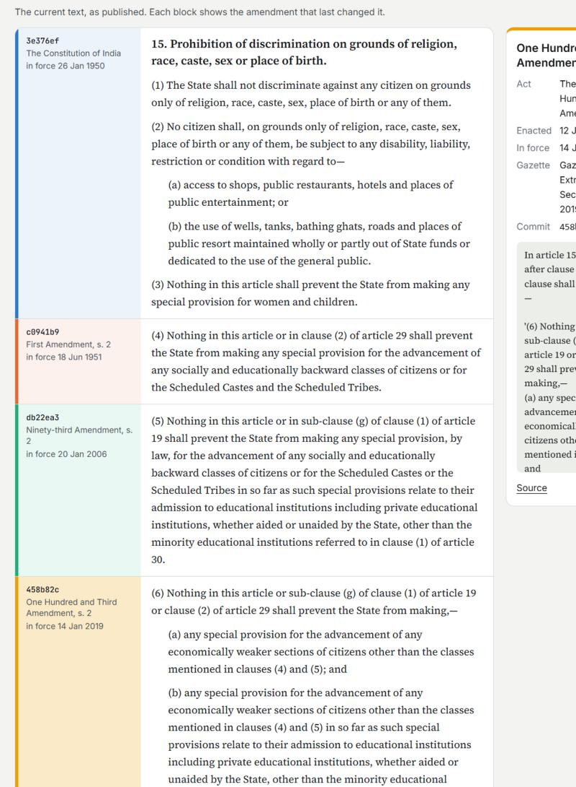

# git blame the Constitution

Every Indian law as a git repository, rebuilt automatically from the text of its amendments.

Parliament changes laws with patches written in English: "for the words 'thirty days', the words 'fifteen days' shall be substituted". People still apply those patches by hand, and the Legislative Department's own dashboard lists central act texts as "under updation". This project trains a small model, **Sanshodhan-1.5B** ("sanshodhan" is Hindi for amendment), that turns amendment text into edit operations. A deterministic engine applies them and a verifier checks the result before anything is committed. The output is a git history of Indian law with blame, diff and time travel, kept current by a bot.

## What exists at the end

| Deliverable | What it is |
|---|---|
| The law, in git | One repository per law, starting with the Constitution and 20 heavily amended central acts, with one commit per amendment |
| The reader | Website: read any act as it stood on any date, blame, diff between dates, permanent links for citing |
| Sanshodhan-1.5B and `amend` | The model on Hugging Face, plus a pip-installable command-line tool (apply, verify, lint) |
| Gazette watcher | A scheduled job that opens a pull request when a new amendment appears |
| Law linter | Reports of references to repealed law (IPC to BNS, CrPC to BNSS, Evidence Act to BSA) and broken cross-references |
| IndiaAmend-200 and write-up | A hand-checked benchmark, a paper, blog posts and a two-minute video |

Acceptance criteria for each one are in [DELIVERABLES.md](DELIVERABLES.md).

## Documents

| File | Contents |
|---|---|
| [PLAN.md](PLAN.md) | Phased implementation plan (M0 to M4), key decisions, data model, architecture, compute, legal checks, risks, and how this runs alongside lost-in-transcription |
| [KICKOFF.md](KICKOFF.md) | How M0 and M1 get built: file formats, commit format, reader data, tasks with done-when, and what needs you |
| [DELIVERABLES.md](DELIVERABLES.md) | Every deliverable with its definition of done |
| [EXPECTED_RESULTS.md](EXPECTED_RESULTS.md) | Metrics, baselines, experiments, targets, and what you can still claim if a target is missed |

## Status

M0 in progress. KICKOFF.md tasks T1–T9 are done: the Constitution's Preamble and Article 15, and the whole Right to Information Act, 2005 (14 commits, including seven Second Schedule notifications up to CERT-In in 2023), build into git repositories whose blame matches the official footnotes. They're public, and reader v0 reads, blames and diffs them on any date. Left for the M0 gate: the hand checks in [notes/m0-gate.md](notes/m0-gate.md).

- Reader: https://kurianjose7586.github.io/git-blame-the-constitution/
- [india-law/constitution](https://github.com/india-law/constitution) ([blame on Article 15](https://github.com/india-law/constitution/blame/main/part-iii/article-015.md))
- [india-law/rti-act](https://github.com/india-law/rti-act)



Build each repository and the reader's data, then serve the reader at http://localhost:8123:

```
uv run publish/build_repo.py history/rti-act.yaml out/rti-act
uv run publish/export.py out/rti-act reader/data/rti-act.json
python -m http.server 8123 --directory reader
```

The same two commands work for `constitution`.

M1 has started: the edit operations and executor (`engine/ops.py`), a first regex baseline (`engine/baseline.py`), and a replay of M0's history through both, which reproduces 12 of its 16 amendments exactly and 15 word for word ([notes/results.md](notes/results.md)):

```
uv run engine/replay.py history/constitution.yaml history/rti-act.yaml
```

The whole current Constitution (Preamble and Parts I–XXII, 471 articles) now parses from the Legislative Department's PDF into law files, with each of its 499 footnotes linked to the lines it covers and the amendment that made them. Every article's words match the source, and the Preamble and Article 15 come out identical to M0's hand-built files. The output stays local until the permission requested under T10 arrives:

```
uv run ingest/pdf.py sources/coi-2026-09-10.pdf out/coi.txt
uv run engine/constitution.py out/coi.txt out/constitution-current
```

Tests: `uv run pytest` and `node --test reader/app.test.mjs`.

## First week

1. Write the amendment history of Article 15 and the Preamble by hand as a YAML list, using India Code and the amending acts as sources.
2. Write the script that turns that YAML into a git repository, and a minimal page that renders blame and diff.
3. Pick the small act for M0 and draft the list of 20 acts. [PLAN.md](PLAN.md) has candidates for both, under M0 and M3.
4. Ask your mentor for a law-faculty contact. You'll need law students for review, and someone to confirm the reuse terms for Indian legal texts before the public launch.

## Links

- Concept mockup (private to you): https://claude.ai/artifact/TjPSty3edyvHhbFByaM7LT
- Sibling project: [../lost-in-transcription](../lost-in-transcription)
- India Code: https://www.indiacode.nic.in
- legislation.gov.uk (training data under the Open Government Licence): https://www.legislation.gov.uk
- Closest prior work, algorithmic legislative consolidation: https://arxiv.org/abs/2501.16794
